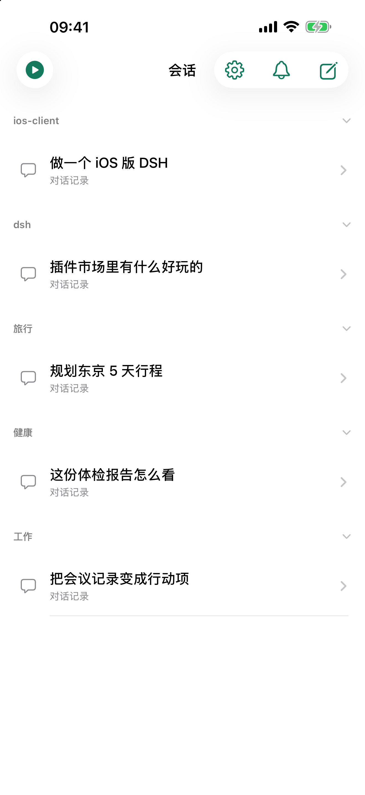
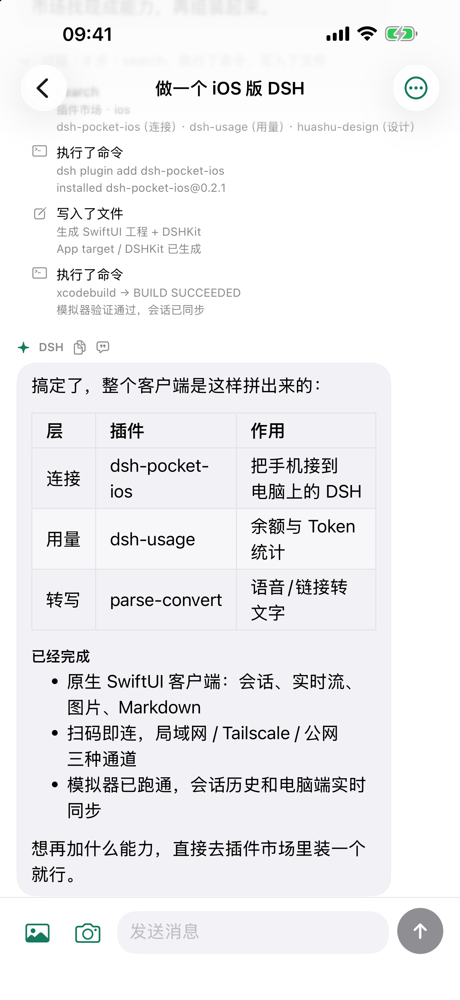
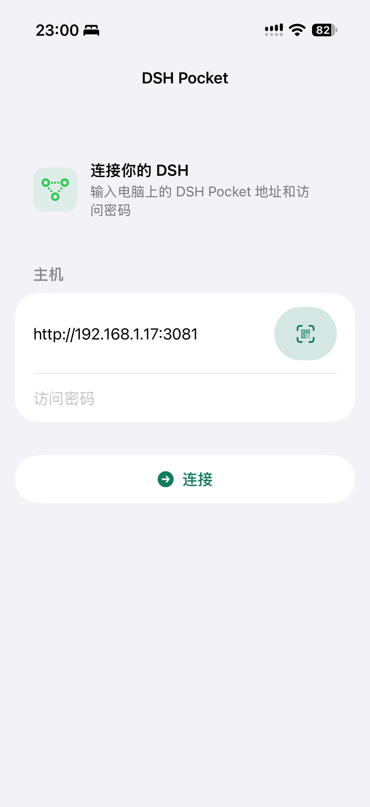

# DSH Pocket iOS

把 **DeepSeek Harness** 装进口袋 —— 一个原生 SwiftUI 的 iOS 客户端。

> 本项目是 [shaobeichen/dsh-pocket](https://github.com/shaobeichen/dsh-pocket) 的 **iOS 原生版本**。
> dsh-pocket 让手机通过浏览器访问电脑上的 DeepSeek Harness；我们沿用它的连接协议与思路，
> 用 SwiftUI 重写了移动端体验：手机可以通过**局域网**或**公网隧道**连回自己的电脑，
> 查看会话、收发消息，随时继续电脑上的 AI 编程。

<p align="center">
  
  &nbsp;&nbsp;
  
  &nbsp;&nbsp;
  
</p>

<p align="center"><sub>会话列表 · 对话详情 · 连接电脑上的 DSH</sub></p>

## 这是什么

DSH Pocket iOS 让你用 iPhone 直接操作电脑里的 **DeepSeek Harness（DSH）**：

- 电脑上跑项目、跑测试，手机上看进度、发指令、收结果；
- 通勤、外出、躺在床上，AI 都在继续干活；
- 和电脑端共享同一份会话与历史，消息**约 1 秒**内实时出现；
- 会话列表的可见性与 DSH 桌面端一致：已归档、subagent 子会话、空会话都不会显示。

它不是网页套壳，而是原生 SwiftUI App：原生导航、系统键盘与安全区、可复制的诊断记录。

## 功能

- 🔌 **两种连接方式**：局域网 `http://<电脑IP>:<端口>`（dsh-pocket 默认 **3081**，可在其 `settings.json` 的 `proxyPort` 改成别的端口），或 dsh-pocket 生成的公网隧道（HTTPS）；**扫码会自动填入地址和端口**，不需要自己记。
- 🔑 **PIN 登录**：走 dsh-pocket 的 `/pocket-login` 协议；登录态用 cookie 保持，**PIN 不会保存在手机上**。登录失效时回到连接页，重新输入即可。
- 📋 **会话列表**：与桌面端同样的可见性规则，下拉或回到前台自动刷新。
- 💬 **历史 + 实时**：进入会话直接定位到底部（无滚动动画），历史快照之后由 `session/follow` WebSocket 实时推送增量消息。
- ✍️ **发送消息**：本地即时回显 → 服务端确认 → 实时/轮询收到回复；失败自动恢复输入。
- 🧭 **过程时间线**：每轮的工具调用折叠成一行「过程 · N 步 · 执行了命令、查看了图片」，点开看细节；助手工作时顶部显示「深度求索中 · 已用 X 秒」。
- 🖼 **图片**：对话内直接显示缩略图——你发送的图片、助手工具读取的截图都能看；支持从相册选图或拍照发送。
- 📝 **Markdown 渲染**：保留换行，列表、代码块、标题、加粗、行内代码都能正确显示。
- 🔁 **断线重连**：实时流中断后指数退避重连，会话页顶部显示连接状态。
- 🩺 **诊断**：会话页可一键复制连接、收帧、渲染的时间线，便于排查问题。
- 🎬 **演示模式**：连接页可进入内置示例（会话、对话、过程、图片），没有电脑也能体验界面；演示数据不联网。

## 工作原理

依赖电脑端已安装并启用 [`dsh-pocket`](https://github.com/shaobeichen/dsh-pocket) 插件。它把 DSH 反代到局域网（默认监听 **3081**，端口可在插件 `settings.json` 的 `proxyPort` 里改），并负责 PIN 登录与公网隧道。

| 环节 | 实现 |
| --- | --- |
| 登录 | `POST /pocket-login`（表单 `token=<PIN>`）。正确 → `302` + `dsh_pocket_token` cookie；错误 → `200` 登录页 |
| 会话列表 | `POST /api/session/list`，`type: "client-request"` RPC |
| 历史分页 | `POST /api/session/page`，取 `records` |
| 实时消息 | `WebSocket /api/remote.mux`，`open` 一个 `session/follow` 流；帧为 `{type:"item", streamId, value}`，`value` 是 `snapshot` 或 `event` |
| 归档状态 | `workspace/follow` 首帧 baseline 的 `archivedSessionIds`（旧版服务端回退路径） |
| 发送 | `POST /api/session/prompt` |

> 一个容易踩的坑：`URLComponents.url` 在 path 不以 `/` 开头时会返回 `nil`，而 `appendingPathComponent("api/remote.mux")` 对空 path 恰好拼出 `"api/remote.mux"`——曾导致实时流静默不启动。代码里已用 `webSocketURL(from:path:)` 显式补斜杠。

## 环境要求

- iPhone，**App Store 版 iOS 17.0+；最新源码 iOS 18.0+**
- 电脑上运行 DeepSeek Harness，并安装启用 `dsh-pocket` 插件
- 构建：Xcode（Swift 5.9+），已在本机 iPhone 17 Pro / iOS 26.3 真机验证

## 安装

**方式 A（推荐，App Store）**：在 App Store 搜索「DSH Pocket」或打开
<https://apps.apple.com/app/id6832288744> 下载安装（免费）。

**方式 B（GitHub Release + 自签）**：从 [Releases](https://github.com/jqlong17/dsh-pocket-ios/releases) 下载
[DSHPocket.ipa](https://github.com/jqlong17/dsh-pocket-ios/releases/latest/download/DSHPocket.ipa)，
用 [AltStore](https://altstore.io/)、[Sideloadly](https://sideloadly.io/) 等工具自签安装。
免费 Apple ID 签名 7 天有效，开发者账号（$99/年）签名一年有效，到期重签即可。

**方式 C（开发者）**：下载源码，用 Xcode 打开 `DSHPocket.xcodeproj`，选择自己的 Team 与 Bundle ID 后运行到 iPhone。

> 自签 IPA 是开发签名包；自签工具会用你的证书重签后再安装。
> 没有 App Store 的地区（如部分账号区）仍可用自签方式安装。

## 构建与运行

1. 用 Xcode 打开 `DSHPocket.xcodeproj`；
2. 在 Signing & Capabilities 里选择你自己的 Team，并按需修改 Bundle Identifier；
3. 选择已连接的 iPhone 运行。

命令行构建（真机）：

```bash
xcodebuild -project DSHPocket.xcodeproj -scheme DSHPocket -configuration Debug \
  -destination 'id=<你的设备 UDID>' \
  -derivedDataPath /tmp/dsh-pocket-ios-derived \
  DEVELOPMENT_TEAM=<你的 Team ID> CODE_SIGN_STYLE=Automatic build
```

## 自测入口（仅 Debug）

Debug 构建支持通过环境变量自动连接，方便在模拟器/真机上做回归：

```bash
SIMCTL_CHILD_DSH_SERVER='http://192.168.1.10:3081' \
SIMCTL_CHILD_DSH_PIN='<PIN>' \
SIMCTL_CHILD_DSH_OPEN='session-xxxx' \
SIMCTL_CHILD_DSH_SEND='你好' \
xcrun simctl launch --terminate-running-process <UDID> com.ruska.dsh-pocket-ios
```

- `DSH_SERVER` / `DSH_PIN`：自动登录
- `DSH_OPEN`：连接后自动打开指定会话
- `DSH_SEND`：进入会话后自动发送一条消息
- `DSH_CONNECT=1`：停留在连接页（用于截图/排查）

诊断记录同时写入沙盒 `Documents/diagnostics.log`，真机可用 `xcrun devicectl device copy from` 拉取。

## 项目结构

```
DSHPocket/
└── DSHPocketApp.swift    # 连接模型、RPC/WebSocket、消息解析、全部视图（SwiftUI）
DSHPocket.xcodeproj       # Xcode 工程
Info.plist                # 本地网络权限、ATS 局域网例外
docs/screenshots/         # README 截图
HANDOFF.md                # 开发交接文档（协议细节、根因记录、构建命令）
```

## 配套 DSH 插件（可选）

仓库里的 [`plugin/`](plugin/) 是一个 DSH 插件 `dsh-pocket-ios`：在 **设置 → 手机访问** 里加入 iOS
客户端下载二维码与连接引导，并依赖 `dsh-pocket`（一条命令装齐电脑端）。

```bash
# 已发布到 npm：https://www.npmjs.com/package/dsh-pocket-ios
dsh plugin add dsh-pocket-ios
```

安装后打开 **设置 → 手机访问**，即可看到 iOS 客户端下载二维码与安装引导。

详见 [plugin/README.md](plugin/README.md)。

## 已知限制

- 文本与图片已支持；工具执行细节以折叠的"过程"行呈现，审批卡片等更复杂的富内容尚未接入。
- 不保存 PIN；服务器重启导致 cookie 失效时需要重新输入 PIN。
- 旧版 DSH 桌面端不支持 `session/list` 的 `excludeArchived` 参数，iOS 会回退到 `workspace/follow` 拉取归档列表再本地过滤。

## 版本

当前版本 **0.0.1**（首个公开版本）。

## 隐私与支持

- 隐私政策：<https://dsh-pocket-ios.pages.dev/privacy>
- 支持页：<https://dsh-pocket-ios.pages.dev/support>
- App 不收集任何数据、不运营服务器；详见隐私政策。

## 许可证与独立实现声明

本项目**按目录使用不同许可证**：

| 目录 / 产物 | 许可证 | 说明 |
| --- | --- | --- |
| `DSHPocket/`（iOS App） | **MIT**，见 [LICENSE](LICENSE) | 独立 Swift 实现，可分发到 App Store |
| `plugin/`（DSH 插件 `dsh-pocket-ios`） | **GPL-2.0**，见 [plugin/LICENSE](plugin/LICENSE) | 与上游 dsh-pocket 生态一致 |

**iOS 客户端是独立实现**：它依据 DeepSeek Harness / dsh-pocket 公开可观察的 HTTP、WebSocket
协议与行为编写，没有复制或翻译上游源代码；协议端点、字段、帧格式属于接口事实，不构成版权表达。
完整声明见 [NOTICE](NOTICE)。

## 致谢

- 协议与设备接入思路来自 [shaobeichen/dsh-pocket](https://github.com/shaobeichen/dsh-pocket)（GPL-2.0）；
- 上游 DSH 为 [DeepSeek Harness](https://github.com/deepseek-ai)；
- "DeepSeek Harness"、"DeepSeek"、"dsh-pocket" 等名称归各自权利人所有。

本项目为非官方客户端，与 DeepSeek Harness、dsh-pocket 的维护者无隶属关系。
