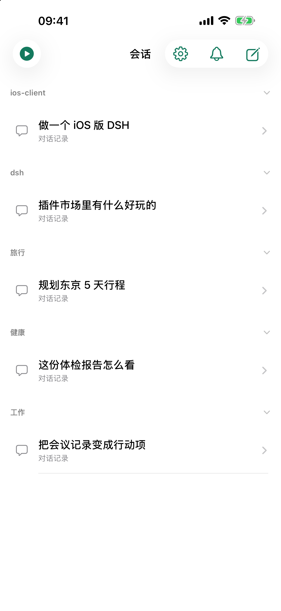
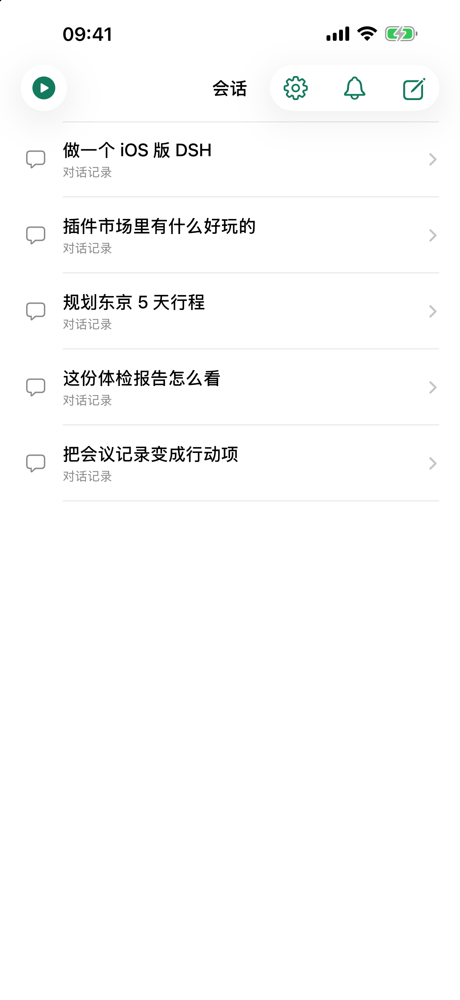
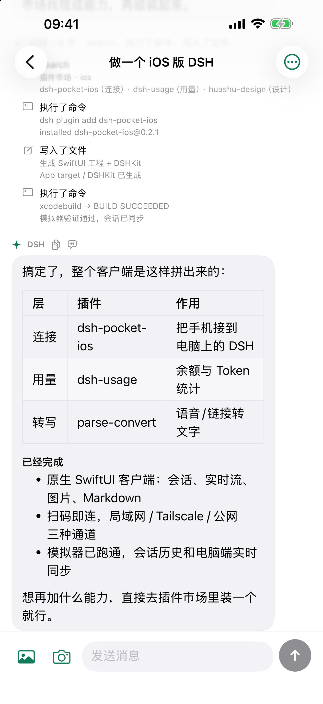
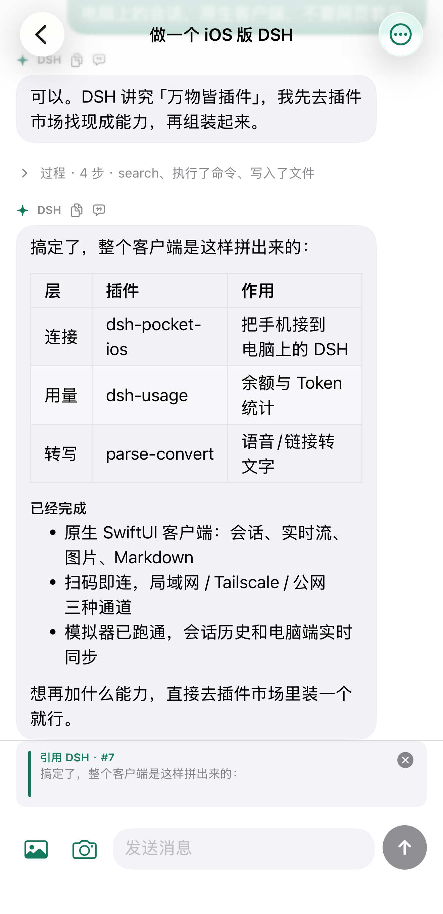
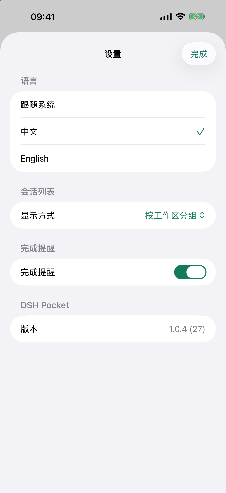
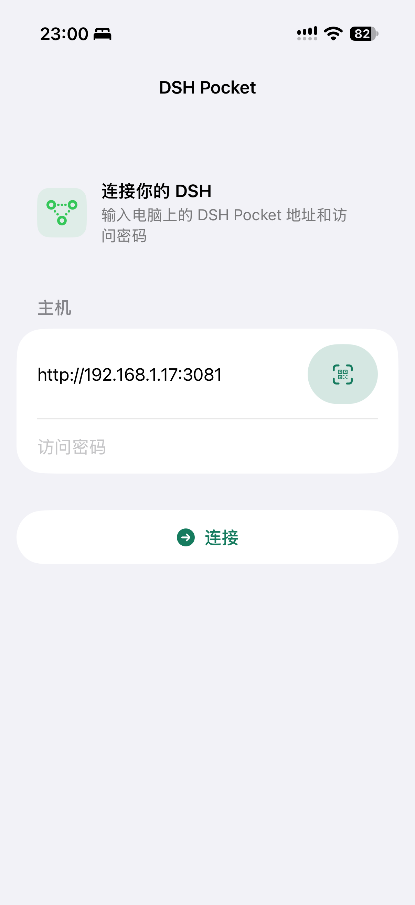
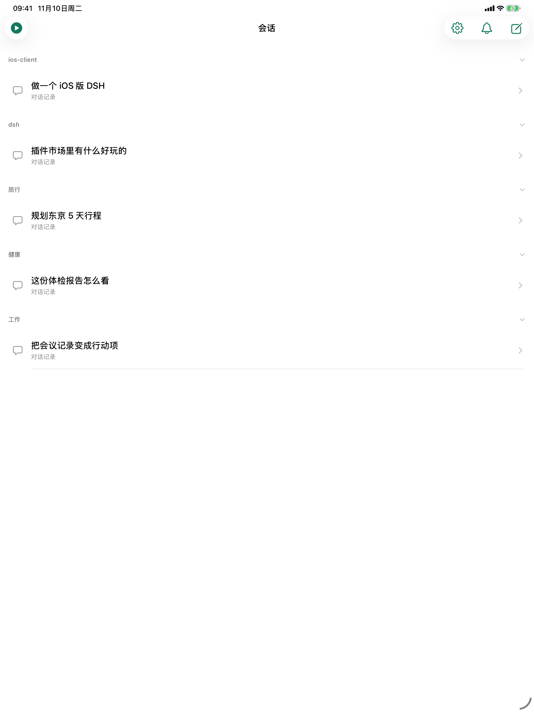
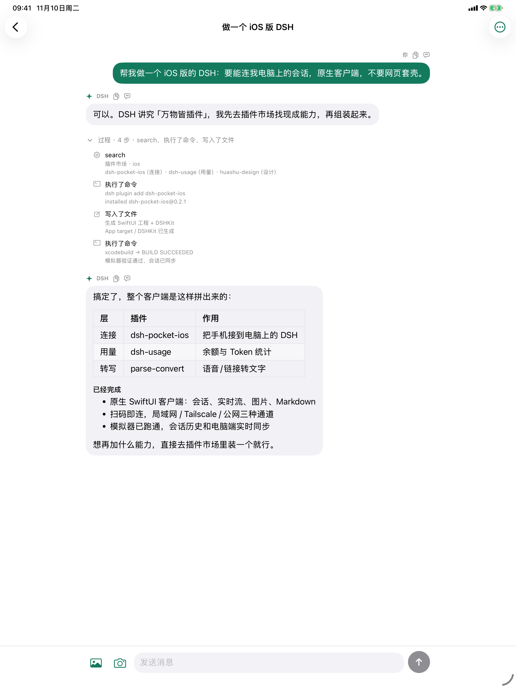

# DSH Pocket iOS

把 **DeepSeek Harness（DSH）** 装进口袋——原生 SwiftUI 的 iOS 客户端 + 配套 DSH 插件。

电脑上继续跑 DSH，手机扫码就能看会话、发指令、接结果；通勤、外出、躺床上都能接着用。

<table align="center">
  <tr>
    <td align="center"><br><sub>工作区分组</sub></td>
    <td align="center"><br><sub>时间线模式</sub></td>
    <td align="center"><br><sub>对话与过程</sub></td>
  </tr>
  <tr>
    <td align="center"><br><sub>引用消息</sub></td>
    <td align="center"><br><sub>设置与语言</sub></td>
    <td align="center"><br><sub>扫码连接</sub></td>
  </tr>
</table>

<table align="center">
  <tr>
    <td align="center"><br><sub>iPad 会话列表</sub></td>
    <td align="center"><br><sub>iPad 对话</sub></td>
  </tr>
</table>

## 产品特色

**一句话**：把电脑上的 AI 编程助手，变成手机上一个「点开就能用」的 App——不用配网络，不用记密码，离开工位也能继续。

### 一、连得上：配置门槛降到「扫一下」

远程访问自己电脑这件事，向来要先折腾网络（端口转发、内网穿透、VPN）。这里把它变成一次扫码：

- **扫码免密**：电脑设置页生成一次性配对二维码（可重复打开、剩余 30 秒自动轮换），手机扫码直接登录；
- **四种连接方式**：局域网 / Cloudflare / Tailscale / EasyTier，随时切换，全部由**一个插件**提供，**手机端多数情况什么都不用装**；
- **服务器也能用**：DSH 装在无图形界面的云服务器上时，用 CLI 在终端出码；
- **连一次长期免密**：设备凭证存进 Keychain（1 年），重装 App、DSH 重启都不用重新扫码。

### 二、连得顺：网络对用户透明

- **自动选路**（默认开启）：同时记住这台电脑的多个地址，**同一个 Wi-Fi 下自动走局域网**（省掉 TLS 握手与隧道封装的固定开销），离开后自动切回最快的隧道；出问题时不会打断正在等回复的会话；
- **连接状态可见**：设置页显示当前方式、状态、地址，以及按地址统计的稳定性评级和最近 20 次时延曲线；
- **两种情况分开说话**：超时或断网提示「重试即可」，配对码过期或密码错误才要求重新扫码。

### 三、看得清：为手机阅读重做过的对话界面

- **实时增量**：`session/follow` 走 WebSocket，不轮询；
- **富文本完整**：Markdown、表格、代码块、图片、引用，原生跨行文字选择；
- **滚动优先于过程**：只把最近几条消息渲染成完整富文本，更早的用纯文本摘要——这是解决长对话滚动掉帧的关键取舍（用户只关心最近几条）；
- **工具过程按需加载**：折叠成「过程 · N 步」，点开才拉正文，收起即丢，不常驻内存；
- **发送可靠**：乐观回显、ACK 后保留至落库、失败重试、生成中可 steer。

### 四、管得住：多任务场景

- 按工作区分组（可展开/收起）或按时间线，两种视图随时切；
- 置顶、归档（可撤销）、长按重命名、搜索；
- 下拉与回前台自动刷新。

### 五、收得到：长任务不盯屏幕

- **完成提醒**：AI 跑完一轮、而你不在看这个会话时提醒你；
- **锁屏也能收到**：用 `BGAppRefreshTask` 定期唤醒 App 检查（**不用远程推送，也不需要任何服务器**）；
- **提醒带内容**：直接显示 AI 回复的开头几句，不是干巴巴的「已完成」；
- **不堆叠**：同一会话的新提醒替换旧的。

> 取舍说明：因为本产品**没有厂商服务器**，iOS 只能按自己的判断调度后台刷新，所以提醒可能延迟几分钟。要「秒级」就必须有中心服务代为发送远程推送——那是另一种产品形态，这里没有采用。

### 六、其他

- **原生体验**：SwiftUI 导航、系统键盘与安全区、原生列表手势、iPad 分栏适配；
- **中英文**：跟随系统 / 中文 / English，设置页、会话、连接页全量覆盖；
- **演示模式**：没有电脑也能体验内置示例，不联网。

## 连接方式

四种方式都在 **DSH → 设置 → 手机访问（iOS）** 里切换，二维码会跟着当前方式变。

| 方式 | 适合 | 手机端要装 |
| --- | --- | --- |
| **局域网** | 手机和电脑同一 Wi-Fi | **什么都不用** |
| **Cloudflare** | 人在外面，任何网络 | **什么都不用**（首次电脑自动下载约 20MB） |
| **Tailscale** | 长期使用、要固定地址 | Tailscale |
| **EasyTier** | 自主组网、不依赖境外服务 | Shadowrocket 等代理 App |

> 不再需要第三方 `dsh-pocket` 插件。

### 局域网（同一 Wi-Fi，最快）

电脑选「局域网」，手机连同一个 Wi-Fi 扫二维码即可。

### Cloudflare（手机零安装）

电脑选「Cloudflare」，首次自动下载 `cloudflared` 并开隧道，之后扫码即连。

> 地址会在 DSH 重启后变化；流量经公网中继，敏感场景建议用局域网或 Tailscale。

### Tailscale（地址固定，长期稳定）

1. 电脑和手机都装 Tailscale、登录同一账号；
2. 电脑执行一次 `tailscale serve --bg 3091`（Tailscale 后台需开启 HTTPS Certificates）；
3. 电脑选「Tailscale」，手机扫码即连。

### EasyTier（自建组网）

电脑装 EasyTier 并**装成 launchd 系统服务**（开机自启、崩溃重启），手机用 Shadowrocket 加载面板给出的订阅配置。详见插件目录的 README。

### 云服务器（没有图形界面）

服务器上没有设置页，用 CLI 在终端出码：

```bash
npx dsh-pocket-ios pair                  # 终端直接打印二维码
npx dsh-pocket-ios pair --png ~/q.png    # 存成图片，发到手机再扫
```

**服务器上推荐 Tailscale**（不开公网端口）；有域名的话也可以用 Caddy/Nginx 反代 `127.0.0.1:3091`。

### CLI

```bash
npx dsh-pocket-ios pair              # 出配对二维码（默认命令）
npx dsh-pocket-ios status            # 当前连接方式、地址、是否就绪
npx dsh-pocket-ios mode tailscale    # 切换连接方式
npx dsh-pocket-ios doctor            # 连不上时先跑这个
```

## 安装

**App（iOS 18+）**：App Store 搜索「DSH Pocket」，或 <https://apps.apple.com/app/id6832288744>。

**电脑端插件**：

```bash
dsh plugin add dsh-pocket-ios
```

安装后重启 DSH 并刷新页面（client 模块在启动时加载）。设置页位置：账号与余额 → 通用设置 → 手机访问 → **手机访问（iOS）** → 模型。

## 功能

- 会话列表：工作区分组 / 时间线两种显示方式；置顶、归档（可撤销）、长按重命名；下拉与回前台自动刷新；
- 对话：历史分页 + `session/follow` 实时增量；工具调用折叠成「过程 · N 步」；Markdown、表格、图片、引用；
- 发送：乐观回显、ACK 后保留至消息落库、失败重试、生成中 steer；401 自动回连接页重新扫码；
- 更多菜单：复制会话地址 / 日志路径 / 诊断信息、选择模型；
- 演示模式：没有电脑也能体验内置示例，不联网。

## 工作方式

依赖电脑端 DSH 与插件。主要接口：

| 环节 | 实现 |
| --- | --- |
| 配对登录 | `POST /dsh-pocket-ios/pair`（一次性 token）→ 302 + `dsh-auth` cookie |
| 会话列表 | `session/list`、baseline 的 `archivedSessionIds` / `pinnedSessionIds` |
| 历史分页 | `session/page` |
| 实时消息 | `WebSocket /api/remote.mux`，`session/follow` 流 |
| 发送 | `session/prompt`（`queue` / `steer`） |
| 会话管理 | `session/rename`、`workspace/pinSession` / `unpinSession`、`workspace/archiveSession` / `unarchiveSession` |
| 模型 | `session/modelCatalog`、`session/selectModel` |
| 图片 | `session/attachment`、`api/file?path=` |

## 构建与测试

```bash
# App（模拟器）
xcodebuild -quiet -project DSHPocket.xcodeproj -scheme DSHPocket -configuration Debug \
  -destination 'generic/platform=iOS Simulator' -derivedDataPath /tmp/dsh-pocket-ios-sim-derived \
  CODE_SIGNING_ALLOWED=NO ARCHS=arm64 build

# 逻辑单测（排序 / 待发消息保留 / 401）
cd DSHKit && swift test

# UI 回归（Demo 模式，无需电脑）
scripts/run-ui-tests.sh <模拟器 UDID>
```

## Debug 自测入口（仅 Debug）

```bash
SIMCTL_CHILD_DSH_DEMO=1 \
SIMCTL_CHILD_DSH_OPEN=demo-1 \
SIMCTL_CHILD_DSH_SEND='你好' \
xcrun simctl launch --terminate-running-process <UDID> com.ruska.dsh-pocket-ios
```

- `DSH_DEMO=1`：演示模式；`DSH_OPEN`：打开指定会话；`DSH_SEND`：自动发送
- `DSH_SERVER` / `DSH_PIN`：自动登录；`DSH_CONNECT=1`：停留在连接页
- 诊断写入沙盒 `Documents/diagnostics.log`

## 项目结构

```
DSHPocket/DSHPocketApp.swift   # 连接模型、RPC/WS、消息与全部 SwiftUI 视图
DSHKit/                        # 本地 Swift Package：传输、协议、同步、Store、UI 组件
DSHPocketUITests/              # Demo 模式 UI 回归
plugin/                        # DSH 插件（dsh-pocket-ios）：设置页、配对、3091 代理
docs/qa-conversation-regression.md
```

## 发布

```bash
# 改好 Info.plist 的版本号/build，提交所有改动后：
./scripts/release.sh              # 打包 → 上传 → 打 tag
./scripts/release.sh --no-upload  # 只打包验证，不上传也不打 tag
```

**版本记录只靠 git tag**（`v1.0.9` 这种格式），**不归档 ipa / dSYM**——
真正需要对比的是代码，不是编译产物。

**一致性由脚本强制保证**（这是重点，否则 tag 会骗人）：

1. **工作区必须干净** — 有未提交改动时，tag 记下的 commit 就不是上传的那份代码；
2. **该版本的 tag 不能已存在** — 一版一 tag，防止同一版本重复发布；
3. **build 号必须大于上一个 tag 的 build** — App Store 会拒绝重复 build；
4. **tag 只在上传成功之后才打** — 上传失败就没有 tag，不会留下「tag 了但没发」的状态；
5. 另外会校验导出 ipa 里的实际版本号，确认 `Info.plist` 真的生效了。

**对比任意两个版本**：

```bash
git diff v1.0.8 v1.0.9              # 代码差异
git log v1.0.8..v1.0.9 --oneline    # 这版包含哪些提交
```

## 链接

- App Store：<https://apps.apple.com/app/id6832288744>
- DSH 插件：<https://www.npmjs.com/package/dsh-pocket-ios>
- 使用说明（飞书）：<https://my.feishu.cn/docx/XyhpdKD2Uo5y1ZxXFbscTpizntc>
- dsh-pocket（第三方，可选）：<https://github.com/shaobeichen/dsh-pocket>

## License

GPL-2.0，见 [LICENSE](LICENSE)。
