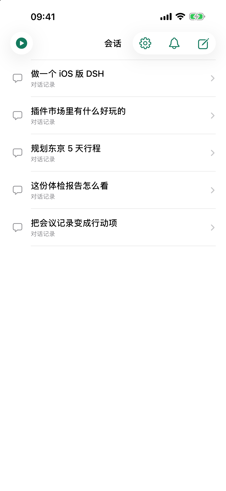
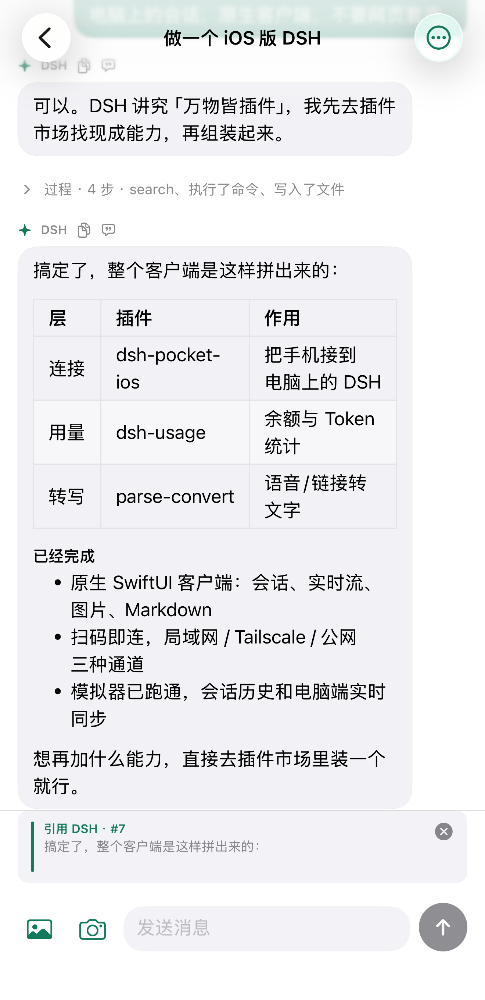
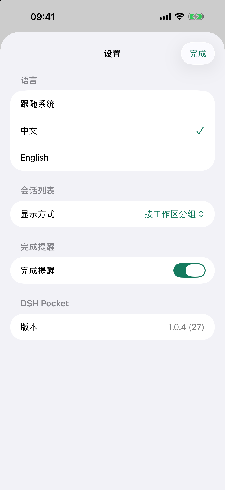
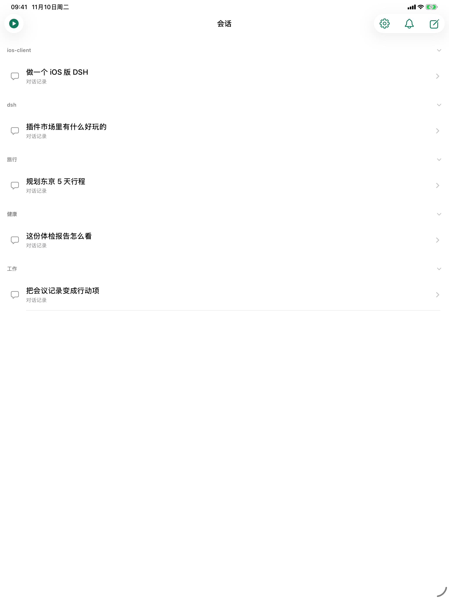
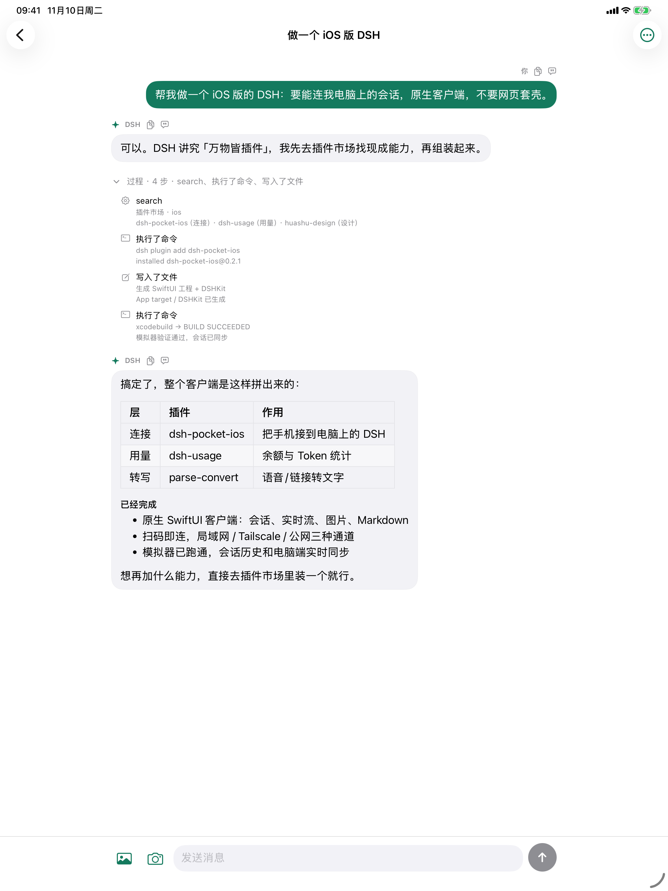

# DSH Pocket iOS

把 **DeepSeek Harness（DSH）** 装进口袋——原生 SwiftUI 的 iOS 客户端 + 配套 DSH 插件。

电脑上继续跑 DSH，手机扫码就能看会话、发指令、接结果；通勤、外出、躺床上都能接着用。

<table align="center">
  <tr>
    <td align="center"><br><sub>工作区分组</sub></td>
    <td align="center"><br><sub>时间线模式</sub></td>
    <td align="center"><br><sub>对话与过程</sub></td>
  </tr>
  <tr>
    <td align="center"><br><sub>引用消息</sub></td>
    <td align="center"><br><sub>设置与语言</sub></td>
    <td align="center"><br><sub>扫码连接</sub></td>
  </tr>
</table>

<table align="center">
  <tr>
    <td align="center"><br><sub>iPad 会话列表</sub></td>
    <td align="center"><br><sub>iPad 对话</sub></td>
  </tr>
</table>

## 亮点

- **扫码免密**：电脑设置页生成一次性配对二维码（60 秒有效、自动轮换、单次使用），手机扫码直接登录；
- **两条连接路线**：Tailscale（固定地址，推荐）或 dsh-pocket（局域网/公网，不装 Tailscale）；
- **原生体验**：SwiftUI 导航、系统键盘与安全区、原生列表手势；
- **会话管理**：按工作区分组（可展开/收起）、置顶、归档（可撤销）、长按重命名；
- **对话**：实时流式回复、工具过程折叠、Markdown、图片、引用、模型切换；
- **中英文**：跟随系统 / 中文 / English，设置页、会话、连接页全量覆盖。

## 连接方式（主推：Tailscale + 扫码配对）

### 推荐：Tailscale 固定地址 + 一次性配对码

**为什么主推**：地址固定、换 Wi-Fi / 切 4G 都不用重新扫码；不暴露公网；扫码免密，体验最接近原生 App。

需要：Mac 装 DSH + `dsh-pocket-ios` 插件；iPhone 装 DSH Pocket + Tailscale（两台设备登录同一账号）。

1. Mac 上执行一次固定入口：

   ```bash
   tailscale serve --bg 3091
   ```

   （Tailscale 后台 DNS 页需开启 HTTPS Certificates）
2. 打开 DSH → 设置 →「手机访问（iOS）」，卡片上会出现一个**自动轮换的配对二维码**；
3. 用 DSH Pocket 扫码 → 自动登录，无需输入密码。

> 读不到 Tailscale 状态时可手写配置：`~/.dsh/dsh-pocket-ios/tailscale.json`，内容 `{"url":"https://你的机器名.你的tailnet.ts.net"}`。

### 备选：dsh-pocket（局域网 / 公网，不装 Tailscale）

需要：Mac 装 DSH + `dsh-pocket` 插件；iPhone 装 DSH Pocket。

在 DSH → 设置 →「手机访问」用 dsh-pocket 的局域网/公网二维码连接，并输入它显示的访问密码。不需要安装 `dsh-pocket-ios`（想要统一设置页和扫码配对再加装）。

> 两个插件可共存：`dsh-pocket-ios` 使用 **3091**，`dsh-pocket` 使用 **3081**。

## 安装

**App（iOS 18+）**：App Store 搜索「DSH Pocket」，或 <https://apps.apple.com/app/id6832288744>。

**电脑端插件**：

```bash
dsh plugin add dsh-pocket-ios
```

安装后重启 DSH 并刷新页面（client 模块在启动时加载）。设置页位置：账号与余额 → 通用设置 → 手机访问 → **手机访问（iOS）** → 模型。

## 功能

- 会话列表：工作区分组 / 时间线两种显示方式；置顶、归档（可撤销）、长按重命名；下拉与回前台自动刷新；
- 对话：历史分页 + `session/follow` 实时增量；工具调用折叠成「过程 · N 步」；Markdown、表格、图片、引用；
- 发送：乐观回显、ACK 后保留至消息落库、失败重试、生成中 steer；401 自动回连接页重新扫码；
- 更多菜单：复制会话地址 / 日志路径 / 诊断信息、选择模型；
- 演示模式：没有电脑也能体验内置示例，不联网。

## 工作方式

依赖电脑端 DSH 与插件。主要接口：

| 环节 | 实现 |
| --- | --- |
| 配对登录 | `POST /dsh-pocket-ios/pair`（一次性 token）→ 302 + `dsh-auth` cookie |
| 会话列表 | `session/list`、baseline 的 `archivedSessionIds` / `pinnedSessionIds` |
| 历史分页 | `session/page` |
| 实时消息 | `WebSocket /api/remote.mux`，`session/follow` 流 |
| 发送 | `session/prompt`（`queue` / `steer`） |
| 会话管理 | `session/rename`、`workspace/pinSession` / `unpinSession`、`workspace/archiveSession` / `unarchiveSession` |
| 模型 | `session/modelCatalog`、`session/selectModel` |
| 图片 | `session/attachment`、`api/file?path=` |

## 构建与测试

```bash
# App（模拟器）
xcodebuild -quiet -project DSHPocket.xcodeproj -scheme DSHPocket -configuration Debug \
  -destination 'generic/platform=iOS Simulator' -derivedDataPath /tmp/dsh-pocket-ios-sim-derived \
  CODE_SIGNING_ALLOWED=NO ARCHS=arm64 build

# 逻辑单测（排序 / 待发消息保留 / 401）
cd DSHKit && swift test

# UI 回归（Demo 模式，无需电脑）
scripts/run-ui-tests.sh <模拟器 UDID>
```

## Debug 自测入口（仅 Debug）

```bash
SIMCTL_CHILD_DSH_DEMO=1 \
SIMCTL_CHILD_DSH_OPEN=demo-1 \
SIMCTL_CHILD_DSH_SEND='你好' \
xcrun simctl launch --terminate-running-process <UDID> com.ruska.dsh-pocket-ios
```

- `DSH_DEMO=1`：演示模式；`DSH_OPEN`：打开指定会话；`DSH_SEND`：自动发送
- `DSH_SERVER` / `DSH_PIN`：自动登录；`DSH_CONNECT=1`：停留在连接页
- 诊断写入沙盒 `Documents/diagnostics.log`

## 项目结构

```
DSHPocket/DSHPocketApp.swift   # 连接模型、RPC/WS、消息与全部 SwiftUI 视图
DSHKit/                        # 本地 Swift Package：传输、协议、同步、Store、UI 组件
DSHPocketUITests/              # Demo 模式 UI 回归
plugin/                        # DSH 插件（dsh-pocket-ios）：设置页、配对、3091 代理
docs/qa-conversation-regression.md
```

## 链接

- App Store：<https://apps.apple.com/app/id6832288744>
- DSH 插件：<https://www.npmjs.com/package/dsh-pocket-ios>
- 使用说明（飞书）：<https://my.feishu.cn/docx/XyhpdKD2Uo5y1ZxXFbscTpizntc>
- dsh-pocket（第三方，可选）：<https://github.com/shaobeichen/dsh-pocket>

## License

GPL-2.0，见 [LICENSE](LICENSE)。
